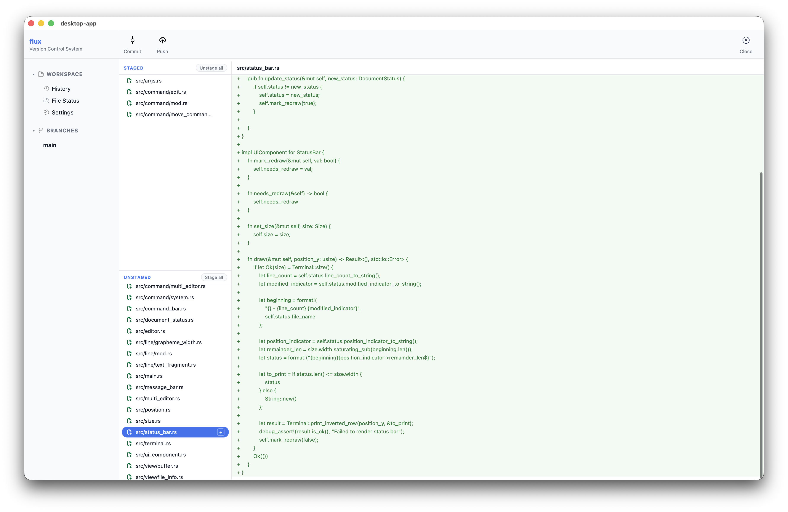

# Flux

Hopefully simple distributed version control system.

## Overview

Flux has two components:

- **Client**: handles local operations (file hashing, object storage, index updates, commits, branch management) and includes a gRPC client for `clone` and `push`.
- **Server**: handles client requests through a shared proto library, manages user authentication, and stores repositories on disk with credential-based access.

A `justfile` is included with the most common build, check, and run commands.

## Tech stack

Here's a brief high-level overview of the tech stack Flux uses:

* This project is written in [Rust](https://www.rust-lang.org/) and built with [Cargo](https://doc.rust-lang.org/cargo/), Rust's package manager and build system.
* For communication between client and server, Flux uses gRPC. The services and messages are defined in a shared proto library, which is compiled with [Protocol Buffers](https://protobuf.dev/) (`protoc`).
* Build, check, and run commands are defined in a `justfile` and executed with [Just](https://github.com/casey/just), a simple command runner.

## Features

* Local object storage: files are hashed and stored as objects, like in Git
* Index and commits: stage changes with the index and create commits
* Branch management: create, switch, and delete branches
* Remote operations: `clone` and `push` over gRPC
* Authentication: the server verifies user credentials and gives secure access to repositories
* Desktop client: a simple, intuitive interface for everyday use
* Git-style commands for both porcelain and plumbing

## Running Locally

```bash
git clone "https://github.com/Balcus/flux.git"
cd flux
just build
just server
```

Then, in another terminal, start the desktop client:

```bash
just desktop
```

## Supported Commands

Porcelain: `add`, `branch`, `clone`, `commit`, `delete`, `diff`, `init`, `log`, `push`, `reset`, `restore`, `set`, `status`
Plumbing: `restore-fs`, `cat-file`, `hash-object`, `commit-tree`
